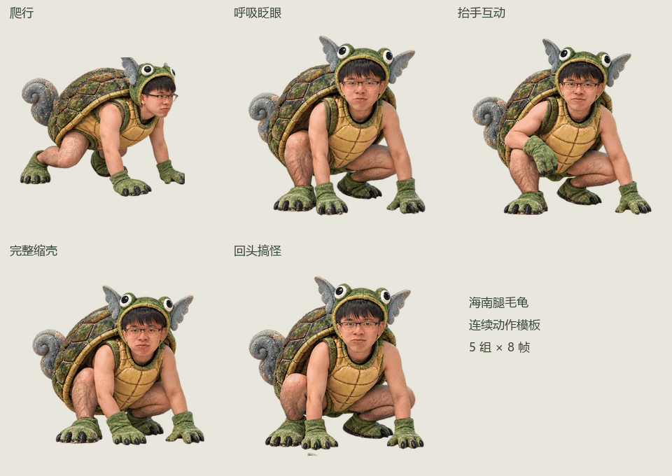

# 海南腿毛龟 · 野生版

写实恶搞风格的 Windows 桌面宠物：真人脸、眼镜、粗糙龟壳、明显腿毛，以及少量灰蓝翅耳和卷尾元素。支持透明窗口、连续爬行、拖动、点击互动、缩壳打盹和托盘退出。



## 下载和运行

从 [Releases](https://github.com/ylasoi/hainan-turtle-desktop-pet/releases/latest) 下载 `HainanTurtlePet.exe`，双击运行。程序面向 Windows 10/11 x64，使用系统的 .NET Framework 4.8；没有 Python、Node 或联网服务依赖。

| 操作 | 效果 |
|---|---|
| 按住左键拖动 | 移动桌宠；松手后落回屏幕底部 |
| 单击 | 抬手互动，偶尔回头做怪表情 |
| 双击 | 龟壳无敌，小幅弹跳 |
| 右键 | 自由爬行、完整缩壳、置顶、大小、归位、退出 |
| 双击托盘图标 | 叫醒并打招呼 |

设置保存在 `%LOCALAPPDATA%\HainanTurtleDesktopPet\settings.xml`。支持多显示器及负坐标显示器；启动时会把已离开当前显示区域的位置移回屏幕。程序只运行一个实例。

## 连续动图模板

素材包中包含 **5 组 × 8 帧，共 40 帧**。每组均提供透明 PNG 序列、精灵表、APNG、动态 WebP 和 GIF。

| 动作 | 名称 | 每帧时长 | 循环时长 |
|---|---|---:|---:|
| 蹲爬步态 | `walk` | 140 ms | 1.12 s |
| 待机呼吸、眨眼 | `idle` | 300 ms | 2.40 s |
| 抬手互动 | `wave` | 160 ms | 1.28 s |
| 完整缩壳再探出 | `sleep` | 300 ms | 2.40 s |
| 回头、翻眼、吐舌等搞怪表情 | `mischief` | 180 ms | 1.44 s |

帧按 `000.png` 到 `007.png` 顺序循环；精灵表为四列两行，先从左到右，再从上到下。模板采用 384 × 384 的透明画布，底部中心锚点为 `(0.5, 0.92)`。

- `assets/frames/<动作>/`：独立 PNG 帧，适用于大多数桌宠引擎。
- `assets/sheets/<动作>.png`：按实际透明轮廓分离、统一留边的规范化精灵表。
- `assets/animations/<动作>.png`：带完整透明度的 APNG 动画。
- `assets/animations/<动作>.webp`：带完整透明度的动态 WebP。
- `assets/animations/<动作>.gif`：兼容 GIF 播放器的循环动画。
- `assets/animations.json`：每组的帧列表、播放间隔、布局和循环信息。
- `assets/sprites.png`：程序内嵌的合并图集，四列十行。

GIF 只有一位透明度；桌宠绘制优先使用 PNG 序列、APNG 或 WebP，以保留腿毛和轮廓的半透明细节。预览 GIF 使用浅色背景，实际 PNG 素材背景透明。

默认待机为双手自然撑地，没有“6”手势。`sleep` 第 4、5 帧为头、手、腿和尾巴全部收进壳里的状态；桌宠睡觉时停留在完全缩壳帧，叫醒后播放伸出动作。绘制使用所有帧共同的裁切区域，缩壳时龟壳不会因为自动居中而上下跳动。

## 从源码构建

在 Windows PowerShell 中运行：

```powershell
powershell -ExecutionPolicy Bypass -File .\build.ps1
.\dist\HainanTurtlePet.exe
```

构建使用系统自带的 .NET Framework C# 编译器，无须安装 NuGet 包。源码位于 `src/`，图片内嵌到单个可执行文件中。

完整本地验证：

```powershell
powershell -ExecutionPolicy Bypass -File .\build.ps1 -Test
```

检查包括全部 40 帧与透明渲染、屏幕边界转向、多屏负坐标、拖动后落地、设置读写及损坏恢复，以及真实分层窗口、菜单状态、缩放、睡眠/唤醒、托盘和退出。GUI 测试短暂显示自己的窗口，并在约六秒后退出。

重新打包素材需要 Python 和 Pillow：

```powershell
python tools/pack_animations.py --walk assets/sheets/walk.png --idle assets/sheets/idle.png --wave assets/sheets/wave.png --sleep assets/sheets/sleep.png --mischief assets/sheets/mischief.png
```

## 来源与许可

这是从头编写的实现，不包含先前提供的其他桌宠可执行程序或其反编译代码。角色与动作素材由图像生成工具依据用户提供的角色参考图制作，采用写实、腿毛和粗糙龟壳的方向；原参考照片未收录到仓库。

代码使用 [MIT License](LICENSE)。角色素材和第三方角色元素的说明见 [NOTICE.md](NOTICE.md)。
